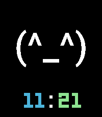
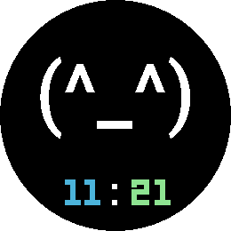

# ASCII Mood

*Express yourself in five characters.*

 

A Pebble watchface (v1.0.0).

ASCII Mood puts a text emoticon on your wrist at full size — the face fills
the display, and the clock steps back into a quiet line underneath it.

Eight moods are built in, from `(^_^)` to `(o_O)`, `(>_<)`, `(;_;)` and
`(-_-)`. Pick one on the settings page, or just **shake your wrist** to flick
to the next one — no menus, no buttons, and it sticks until you change it
again. A short buzz confirms the switch, and if you would rather keep one
face for good, shake switching turns off.

The face is drawn in a proper typeface rather than the built-in system
fonts, so it reads as a deliberate piece of lettering at 90 pt rather than
oversized small print. Hours, colon and minutes each take their own colour,
so the time can pick up an accent without competing with the face.

Nothing else is on the screen. No date, no steps, no battery bar — just a
face and the time, on a background you choose.

Built for Pebble Time 2 and Pebble Round 2, with the face sized for each
display. The clock follows whatever 12-hour or 24-hour setting your watch
is already using.

## Settings

- **Face** — which of the eight moods to show. Shaking the watch moves to
  the next one from wherever you are.
- **Shake to change mood** — turn this off to keep the mood fixed to what
  you picked above.
- **Background** — the colour behind everything.
- **Face** — the colour of the emoticon.
- **Hour digits**, **Colon**, **Minute digits** — the three parts of the
  clock, coloured separately.

## Platforms

- Pebble Time 2 (`emery`)
- Pebble Round 2 (`gabbro`)

## Building

With the [Pebble SDK](https://developer.repebble.com/sdk/):

```bash
pebble build
pebble install --emulator emery
```

The repository can also be imported into CloudPebble as is.

## Release notes

### 1.0.0

First release.

## License

MIT License, see [LICENSE](LICENSE). The bundled fonts are not covered by it and
remain under their own licenses.
